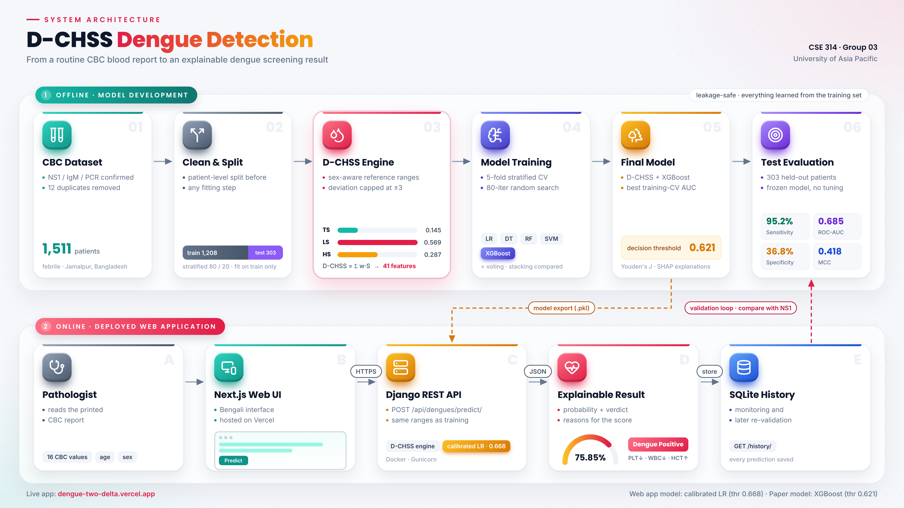
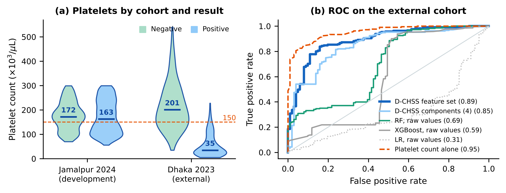

# How Far Can a Routine Blood Count Go? Realistic Performance, Resampling Leakage and External Validation of CBC-Based Dengue Detection in Bangladesh

**CSE 314 — Machine Learning and Deep Learning · Group 03 · University of Asia Pacific**
Course teacher: Rashik Rahman, Assistant Professor, Department of CSE

This project asks three questions: what is the realistic, leakage-free performance of dengue detection from a routine complete blood count (CBC), how much does class resampling before the train/test split inflate reported results, and does a model built in one hospital work in another? As an interpretable component we use D-CHSS (Dengue Clinical Hematological Signature Score), which turns 16 routine CBC values into capped, sex-aware deviations from clinical reference ranges and groups them into three interpretable scores: thrombocytopenia (TS), leukocyte response (LS) and hemoconcentration (HS). Together with the raw values, the deviations and five hematological ratios, the signature forms a 41-feature set for an XGBoost classifier. The project also includes an external validation on a second public cohort from two Dhaka hospitals and a Bengali-language web application.

- **Live web app:** https://dengue-two-delta.vercel.app/
- **Web app source:** frontend https://github.com/shifat35/dengue-frontend · backend https://github.com/shifat35/dengue-backend
- **Report (IEEE format):** [`D-CHSS_Report_Group03.pdf`](D-CHSS_Report_Group03.pdf)



## Main results (303 held-out test patients)

| Model (each at its own Youden threshold) | Recall | Specificity | F1 | ROC-AUC | MCC |
|---|---|---|---|---|---|
| Random Forest (raw CBC) | 0.889 | 0.453 | 0.831 | 0.663 | 0.384 |
| XGBoost (raw CBC) | 0.909 | 0.432 | 0.838 | 0.658 | 0.396 |
| **D-CHSS + XGBoost (ours)** | **0.952** | 0.368 | **0.850** | **0.685** | **0.418** |
| Web-app logistic regression | 0.875 | 0.484 | 0.829 | 0.711 | 0.392 |

- 95% bootstrap CI of our test ROC-AUC: 0.615–0.757; DeLong test against Random Forest: p = 0.229.
- Over 10 repeated splits (whole pipeline re-run): ours 0.688 ± 0.030, Random Forest 0.685 ± 0.032, raw XGBoost 0.683 ± 0.030. The gain over strong baselines is within noise; routine CBC data reach about 0.69 ROC-AUC on this cohort.
- Resampling before the train/test split raised a stacking ensemble's accuracy from about 75% to 92% on the same data. This does not show that any published study leaked; it shows that the order of resampling and splitting must be reported.
- D-CHSS was higher in dengue-negative patients in every Jamalpur split, but not in Dhaka (discussed in the report).

## External validation (312 patients, two Dhaka hospitals, 2023)

Models were developed on all 1,511 Jamalpur patients using the ten variables both cohorts share, then applied once, unchanged, to the Dhaka cohort of Riya et al.

| Model | Jamalpur CV ROC-AUC | Dhaka ROC-AUC [95% CI] |
|---|---|---|
| Logistic regression (raw) | 0.640 | 0.314 [0.252, 0.375] |
| Random Forest (raw) | 0.695 | 0.691 [0.628, 0.756] |
| XGBoost (raw) | 0.685 | 0.593 [0.515, 0.672] |
| XGBoost on D-CHSS components (4) | 0.682 | 0.849 [0.800, 0.891] |
| **XGBoost on D-CHSS feature set (25)** | **0.704** | **0.888 [0.846, 0.923]** |
| Platelet count alone | 0.528 | 0.954 [0.931, 0.973] |

Features anchored to fixed clinical reference ranges transferred far better than raw values, but the platelet count alone was strongest in Dhaka and almost useless in Jamalpur: CBC-based performance depends strongly on case mix.



## Files

| File | What it is |
|---|---|
| `dengue-detection4.ipynb` | main research notebook (data → features → models → evaluation → SHAP) |
| `D-CHSS_Report_Group03.pdf` | IEEE double-column report |
| `D-CHSS_Lab_Final_Presentation_Group03.pptx` | lab-final slides |
| `run_notebook.py` | re-runs the notebook and saves `outputs/state.pkl` |
| `equal_threshold_comparison.py` | every model at its own training-CV Youden threshold |
| `repeated_splits.py` | whole pipeline for one split seed (`python repeated_splits.py 7`) |
| `bootstrap_delong_ppv.py` | bootstrap CIs, DeLong tests, PPV/NPV, age subgroups |
| `resampling_leakage.py` | leak vs. leak-free resampling experiment |
| `external_validation.py` | train in Jamalpur, test once on the Dhaka cohort (Table VII, Fig. 13) |
| `architecture.png`, `external_validation.png` | figures |

## How to run

1. Download the public **Dengue Fever Hematological Dataset** (Mendeley Data, v2): https://data.mendeley.com/datasets/6fsrsk3mb8/2 and save it as `data/Dengue_Fever_Hematological_Dataset.csv`. For the external validation, download `CBC Report.csv` from https://github.com/mritunjoychk17/Dengue-Prediction-in-Bangladesh-Using-Machine-Learning and save it as `data/CBC_Report_Dhaka.csv`.
2. `pip install pandas numpy scikit-learn xgboost shap statsmodels matplotlib seaborn imbalanced-learn`
3. From the repository root:
   ```bash
   python run_notebook.py              # notebook pipeline, saves outputs/state.pkl
   python equal_threshold_comparison.py
   python bootstrap_delong_ppv.py
   python repeated_splits.py 42        # repeat for seeds 1..9
   python resampling_leakage.py
   python external_validation.py
   ```
   Or open `dengue-detection4.ipynb` directly (change `DATA_PATH` to the CSV above).

## Team

| Name | ID |
|---|---|
| Tashnimul Hasan Shifat | 23101142 |
| Sultan Ruhul Kuddus Nayan | 23101159 |
| Anjuma Alam | 23101164 |
| Fairoj Salim | 23101165 |

## Notes

- Research and teaching project only; it is **not** a medical diagnostic tool. Every positive result must be confirmed by NS1, serology or PCR.
- The dataset is public and anonymized, so no separate ethics approval was needed.
- AI assistance is declared in the report (Declaration of AI Usage).
